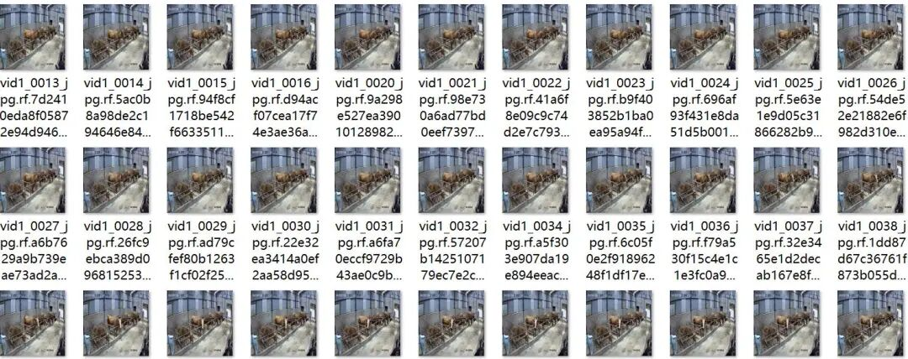
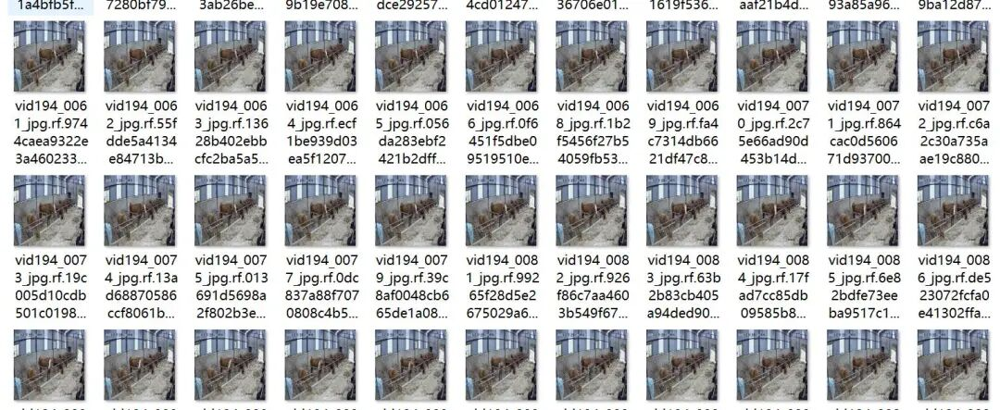
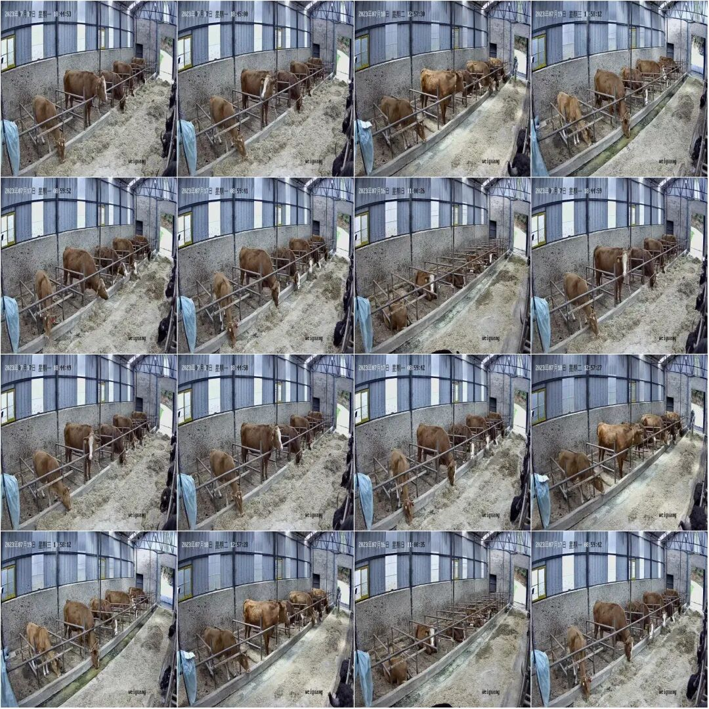
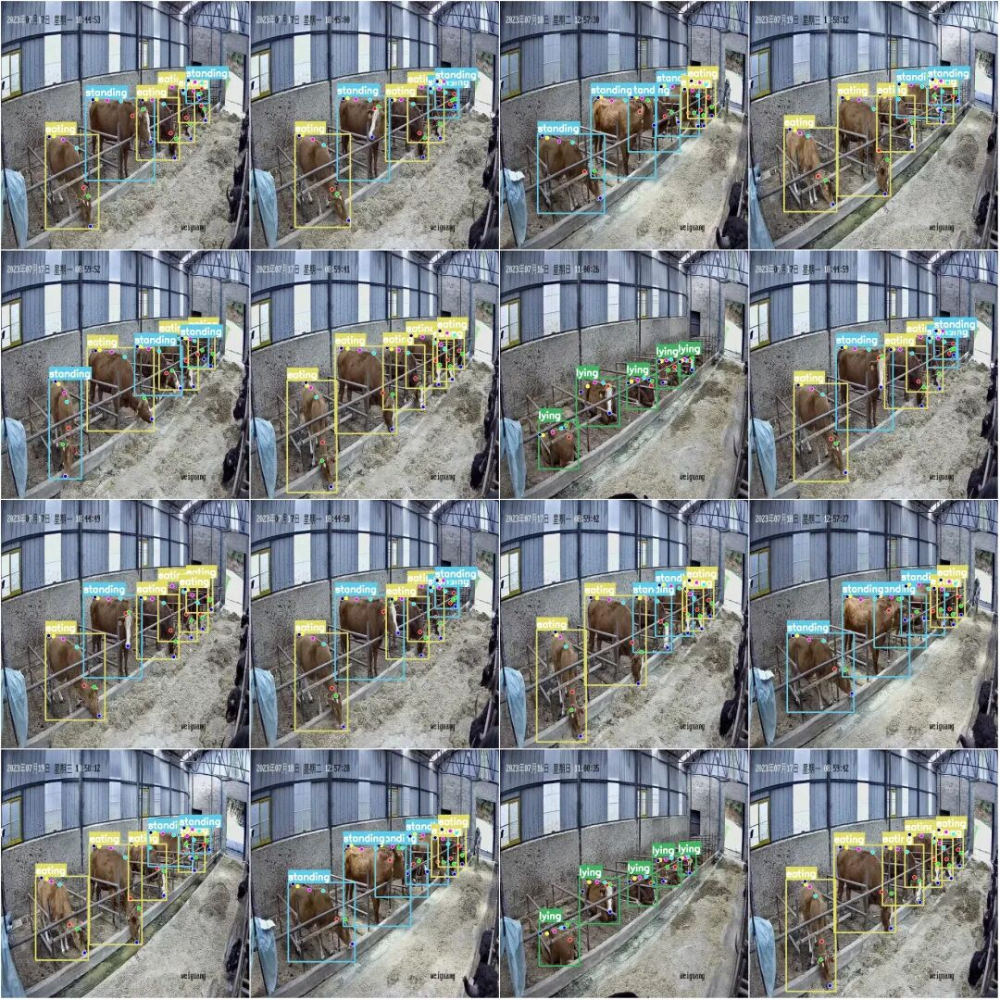

# Livestock farms - key pose estimation detection dataset for COCO+YOLO format with 497 images in 3 categories and 7 key points

Dataset format: YOLO keypoint format (Note that this is not the YOLO format for object detection or segmentation, but merely includes jpg images and corresponding yolo format txt files).

Number of images (number of jpg files): 497

Number of annotations (number of txt files): 497

Number of training set: 397

Number of validation set: 50

Number of test sets: 50

Label category count: 3

Label category names: ['eating', 'lying', 'standing']

Key Category: ["nose", "head_top", "neck", "shoulder", "back_mid", "hip", "tail_base"]

Number of key points marked: 7

Number of boxes labeled in each category:

Eating frame count = 1368

Lying frame count = 496

Number of standing frames = 1028

Total frame count = 2892

Image resolution: 640x640

Important Notice: The dataset has been divided into training, validation, and test sets. These can be directly used for training Yolov5-pose, Yolov8-pose, Yolov11-pose, or Yolov26-pose.

Special : This dataset does not guarantee the accuracy of the trained models or weight files.

Image Preview:

Annotation example:

Original image (pick 16 randomly):

Annotation:

Dataset address:

## Payment

Here is a pay link on Stripe ( https://buy.stripe.com/3cs8yP7sY87d0vu9AB ). Please contact me lonlonago@foxmail.com after funding $89, and I will send you a complete data files , thank you!

